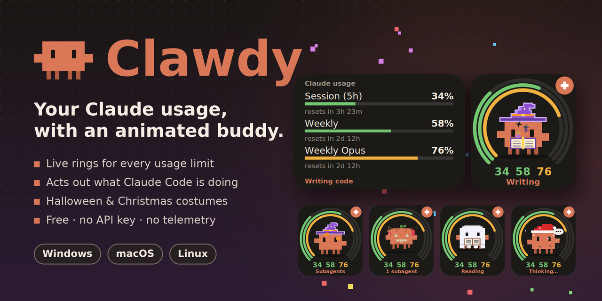
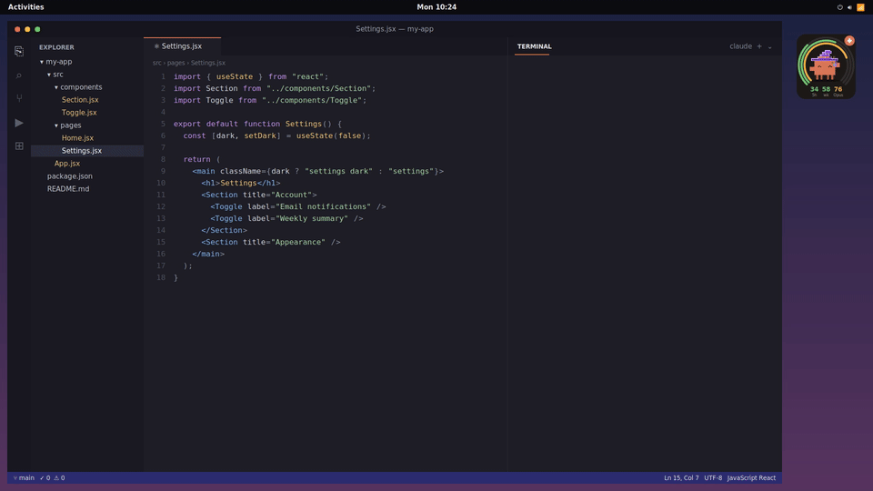
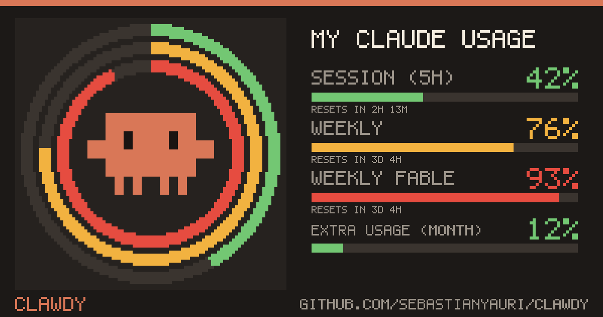
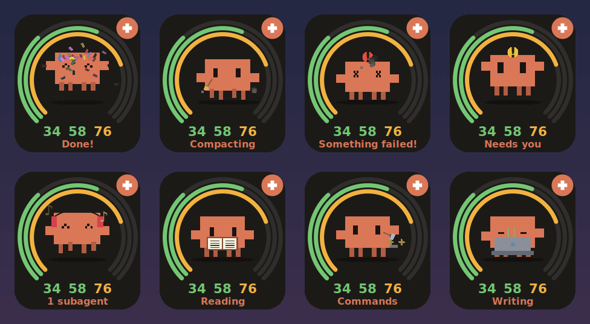
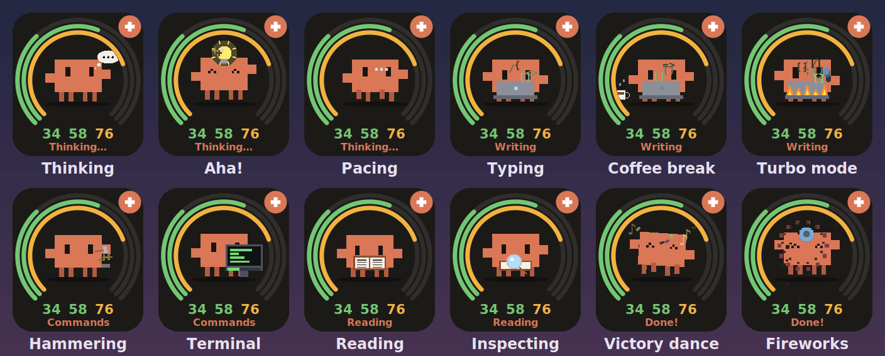
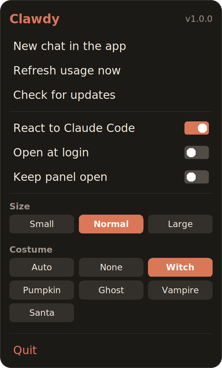
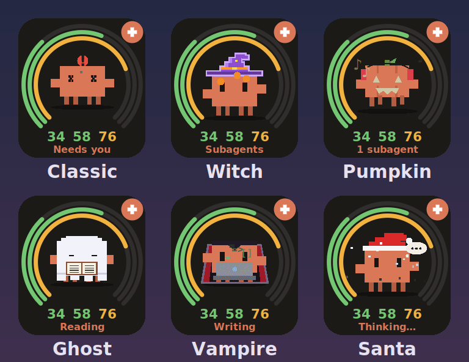

  

  
  
  
  

**Clawdy** is a tiny desktop buddy that sits in a corner of your screen and
shows **how much of your Claude plan you've used**. While Claude Code works,
Clawdy acts it out: it thinks, types on its laptop, hammers away at commands,
juggles subagents… and throws confetti when the job is done.

  

Clawdy reacting live to a Claude Code session · <a href="docs/media/desktop.mp4">watch in HD (MP4)</a>

## Features

- **Usage at a glance.** Three rings around Clawdy show your 5-hour session,
  your weekly limit and, if your plan has one, a per-model weekly limit.
  Green, yellow from 70 %, red from 90 %.
- **Details on hover.** Move the mouse over it and a panel slides out with every
  limit and when it resets, including paid extra usage if you turned it on.

  

- **Reacts to Claude Code.** Through Claude Code hooks, Clawdy knows when Claude
  is thinking, writing code, running commands, reading files, using subagents,
  compacting context, waiting for you or hitting an error. Each state rotates
  through a few animations so long sessions stay fun: a light bulb going *aha!*,
  coffee breaks, turbo typing with a keyboard on fire, a scrolling terminal, a
  magnifying glass, victory dances and fireworks. Leave it alone long enough and
  it takes a nap.
- **Costumes.** Witch, pumpkin, ghost, vampire and Santa, each with its own
  tricks and themed props. On *Auto* it dresses up by itself for Halloween and
  Christmas.
- **Alerts near your limits.** At 80 % and 95 % of any limit Clawdy raises the
  alarm and sends a system notification, once per reset window.
- **"Claude finished" and "Claude needs you".** Started a long task and switched
  to another window? When Claude Code finishes a long task (5 minutes or more by default; pick
  30 s, 1, 2 or 5 min in the menu) or stops halfway
  to ask your permission, you get a notification and a little 8-bit
  sound, and Clawdy tells you which project it was.
- **Share your usage.** Right-click → **Share my usage** saves a pixel-art card
  with Clawdy and your limits to your Pictures folder and opens it, ready to
  post wherever you like.

  

- **Desktop walks.** While you're using Claude, now and then Clawdy leaves its
  porthole: on Windows it rappels down to the taskbar, strolls along it and
  climbs back up a rope; on Linux and macOS it hangs from the top of the screen,
  swings along and slides back down a rope. Click it to get a wave. You can turn
  walks off from the right-click menu.
- **One click to a new chat.** The **+** button opens a new chat in the Claude
  desktop app, or on claude.ai if the app isn't installed.
- **Updates itself.** Checks GitHub Releases at start-up and every 6 hours.
- **Free and private.** No API key, no extra cost, no servers, no telemetry.
- **English and Spanish**, following your system language.

  

  

## Download

### One command

Paste one line in a terminal and Clawdy installs and opens. No browser
downloads, so no SmartScreen or Gatekeeper warnings either.

| Your computer | Command |
|---|---|
| **Windows** (PowerShell) | `irm https://raw.githubusercontent.com/SebastianYauri/clawdy/main/get.ps1 \| iex` |
| **macOS / Linux** (Terminal) | `curl -fsSL https://raw.githubusercontent.com/SebastianYauri/clawdy/main/get.sh \| sh` |
| **Windows** ([Scoop](https://scoop.sh)) | `scoop bucket add sebastianyauri https://github.com/SebastianYauri/scoop-bucket` `scoop install clawdy` |
| **Mac** ([Homebrew](https://brew.sh)) | `brew install --cask sebastianyauri/tap/clawdy` |

The scripts are short and readable: [get.ps1](get.ps1), [get.sh](get.sh). On
Ubuntu/Debian `get.sh` installs the `.deb` (it asks for your password); on Intel
Macs, Fedora, Arch and others it installs from source with Python.

### Or download the installer

Get the file for your computer from the
**[latest release](https://github.com/SebastianYauri/clawdy/releases/latest)**:

| Your computer | File | How to install |
|---|---|---|
| **Windows 10 / 11** | `Clawdy-Setup.exe` | Double-click it and follow the steps. No admin rights needed. |
| **Ubuntu, Debian, Mint** | `clawdy_…_all.deb` | Double-click it → **Install**, or `sudo apt install ./clawdy_*_all.deb`. |
| **Mac (Apple silicon)** | `Clawdy-mac.dmg` | Open it and drag *Clawdy* into *Applications*. |

Clawdy reads your usage from [Claude Code](https://claude.com/claude-code). Only
have the Claude desktop app? Clawdy still works (mascot, chat button, walks), and
clicking **Click to see your usage** sets Claude Code up for you in the
background with the official installer: all you do is click **Authorize** in the
browser window that opens. No terminal, no commands. The first time Clawdy opens it
explains what it does and asks before connecting to Claude Code or starting at
login.

> [!NOTE]
> **Edge blocks the download?** New apps aren't "commonly downloaded" yet. Open
> the downloads list (**Ctrl + J**), point at `Clawdy-Setup.exe`, click **⋯** →
> **Keep**, then **Show more** → **Keep anyway**.
>
> **Windows says "Windows protected your PC"?** That's normal for new apps
> without a paid code-signing certificate. Click **More info** → **Run anyway**.
> It only happens once.
>
> **macOS says "Apple could not verify Clawdy is free of malware"?** The Mac build
> isn't signed with a paid Apple Developer ID yet, so the first launch needs one
> extra step (later updates don't):
> 1. Click **Done** in that dialog.
> 2. Open **System Settings → Privacy & Security**, scroll down to *"Clawdy was
>    blocked…"* and click **Open Anyway**, then confirm with your password.
>
> Prefer the Terminal? `xattr -dr com.apple.quarantine /Applications/Clawdy.app`
> does the same.
>
> When macOS then asks whether *Clawdy* may use *Claude Code-credentials*, click
> **Always Allow**: that's your Claude Code session, which Clawdy needs to read
> your usage. macOS may ask this again after an update.

**Windows Package Manager:** `winget install SebastianYauri.Clawdy` is coming soon; the
package is [in review](https://github.com/microsoft/winget-pkgs/pull/462441). Installing with
winget skips the browser and SmartScreen warnings.

**Other systems** (Intel Macs, Fedora, Arch…): use `get.sh` above, or with
Python 3.8+ and tkinter clone the repo and run `python3 install.py`. See
[Building](docs/building.md).

## Using it

| Do this | To |
|---|---|
| Hover | Slide out the panel with every limit and its reset time |
| Click Clawdy | Your Claude Code chats: bring an open one to the front, resume a recent one, or start a new chat in a recent project |
| Click **+** | Start a new Claude chat |
| Click the **pin** (top left) | Pin Clawdy in place so dragging doesn't move it; click again to free it |
| Drag | Move Clawdy anywhere: it dangles from the mouse, and gets dizzy if you shake it |
| Right-click | Open the menu |
| Tray / menu bar icon | Show or hide Clawdy, new chat, share, refresh, every setting, quit |

  

The right-click menu has the tools: new chat, **Share my usage**, refresh and
check for updates. **Settings…** (there or in the tray icon) opens every option:
React to Claude Code, Open at login, walks, alerts, notifications and how long a
task must take to notify you, sounds, size and costume.

Clawdy also has an icon in the system tray (the menu bar on macOS). Choose
**Hide (keep in tray)** to tuck it away: it keeps running in the background and
you can bring it back, or quit, from that icon.

### Costumes

  

The witch flies on her broom, reads a crystal ball while Claude thinks,
writes in a spellbook and stirs a cauldron when commands run. The ghost floats
and says boo, the pumpkin rolls and glows, the vampire turns into a bat and
Santa pulls out presents.

## Does it cost anything?

No. Clawdy reads the same numbers you see with `/usage` in Claude Code, using
the session Claude Code already has on your computer. Checking costs nothing
from your plan and uses no API key. It asks at most once every 5 minutes.

Everything stays on your computer. The only other request Clawdy makes is to
this GitHub repository, to see whether there is a new version. Details in
[How it works](docs/how-it-works.md).

## Is it safe?

Clawdy is open source and every installer is built from this repository by
[GitHub Actions](https://github.com/SebastianYauri/clawdy/actions), never on a
personal computer. Each release lists the SHA-256 of its files in
`SHA256SUMS.txt`.

✅ **68 of 72 antivirus engines find nothing** in the current Windows installer, including
Microsoft Defender, Kaspersky, ESET, Malwarebytes, McAfee, Sophos, Symantec and BitDefender.
The few remaining ones are known false positives that show up for most Python desktop apps.
You can also skip the installer entirely: `python3 install.py` runs Clawdy straight from the source code.

## Updates

- **Windows and macOS** update silently and reopen. Installed with Scoop? Run
  `scoop update clawdy`.
- **Ubuntu/Debian** shows *"click to update"*; the system then asks for your
  password, like any package install.
- Right-click → **Check for updates** to look right away.

## Uninstall

- **Windows**: Settings → Apps → *Clawdy* → Uninstall. This also disconnects it
  from Claude Code.
- **Ubuntu/Debian**: first right-click Clawdy and turn off *React to Claude
  Code*, then `sudo apt remove clawdy`. (If you skip the first step nothing
  breaks: the hook simply does nothing once Clawdy is gone.)
- **macOS**: right-click Clawdy, turn off *React to Claude Code* and *Open at
  login*, quit, and move the app to the Trash.
- **From source**: `python3 install.py --uninstall`.

## Documentation

- [How it works](docs/how-it-works.md): usage data, hooks, files it touches, updates
- [Building](docs/building.md): run from source, build the installers
- [Contributing](CONTRIBUTING.md)
- [Changelog](CHANGELOG.md)

## Credits

Clawdy is a fan project inspired by Clawd, the Claude Code mascot, and by
[Clawdmeter](https://github.com/HermannBjorgvin/Clawdmeter) and
[Clawd on Desk](https://github.com/rullerzhou-afk/clawd-on-desk). All artwork
and animation is drawn in code; no files from those projects are used.

Not affiliated with or endorsed by Anthropic. Claude and Claude Code are
trademarks of Anthropic.

Released under the [MIT License](LICENSE).
